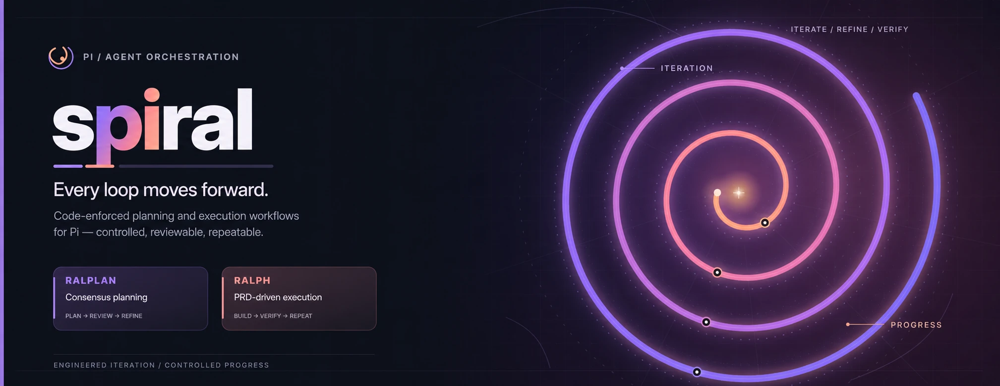

# pi-spiral

Ask an agent to build something non-trivial and it grades its own homework:
the plan goes unchallenged, "done" means "I think it works", and long tasks
drift. Spiral adds two loops to [pi](https://github.com/earendil-works/pi)
that fix this with independent reviewers and real checks.

- **`/ralplan`** — a planner writes the plan, an architect and a critic
  pick it apart, up to 5 rounds. You get a reviewed plan. Nothing is executed.
- **`/ralph`** — splits the work into stories with acceptance criteria,
  implements them one by one, runs your tests after each, and finishes only
  when a separate reviewer confirms every criterion with evidence. Never
  commits.

The loops run in code, not in a prompt, so the model can't skip a step.

## Install

```bash
pi install git:github.com/akholod/pi-spiral
```

Works right away: every role uses your current pi model.

## Use

```text
/ralplan add rate limiting to the API               # plan only
/ralph --plan .spiral/plans/<file>.md implement it  # build from a plan
/ralph fix the flaky login test                     # or build straight away
```

| Command                            | What it does                                                                                                       |
| ---------------------------------- | ------------------------------------------------------------------------------------------------------------------ |
| `/ralplan <task>`                  | Plan. `--deliberate` adds a pre-mortem and more tests; `--interactive` asks you about the draft and the final plan |
| `/ralph <task>`                    | Build. `--resume` continues a stopped run, `--no-deslop` skips the cleanup pass                                    |
| `/ralplan-cancel`, `/ralph-cancel` | Stop a run                                                                                                         |
| `/spiral-preset`                   | Pick a preset for this session                                                                                     |
| `/spiral-config`                   | Show the effective settings and where they came from                                                               |
| `/agents`                          | See running child agents, cancel or take over                                                                      |

The model can call both loops too, as the `ralplan` and `ralph` tools.

## Models and presets

A reviewer on the same model as the author tends to agree with it. For a
real second opinion, put the critic and the reviewer on another provider.
Do it in `spiral.json`:

- `~/.pi/agent/spiral.json` — yours, for every project
- `.pi/spiral.json` — per project, overrides yours key by key

```json
{
  "ralplan": { "roles": { "critic": { "model": "openai-codex/gpt-6-sol" } } },
  "ralph": { "roles": { "reviewer": { "model": "openai-codex/gpt-6-sol" } } }
}
```

Every role takes `model` (`inherit` or `provider/model`), `thinking`
(`off` … `max`) and `timeoutMs`. All keys, with comments:
[spiral.config.example.jsonc](spiral.config.example.jsonc).

**Presets** switch effort in one word. Built in: `lite` (fewer rounds, less
thinking) and `deep` (pre-mortem always, more thinking). Define your own
under `presets` with any models you like, then:

```text
/ralplan --preset deep <task>    # one run
/spiral-preset                   # this session
"defaultPreset": "lite"          # always, in spiral.json
```

## Good to know

- ralph never commits and never pushes. Review the diff yourself.
- ralph asks before running test commands it guessed. Set `ralph.verify`
  to skip the question.
- Tests that already fail before the run don't block it; new failures do.
- Plans go to `.spiral/plans/`, run state to `~/.pi/agent/spiral/ralph/`.

How it works inside: [docs/ARCHITECTURE.md](docs/ARCHITECTURE.md).
Decisions: [docs/adr](docs/adr). Based on
[oh-my-claudecode](https://github.com/Yeachan-Heo/oh-my-claudecode).
